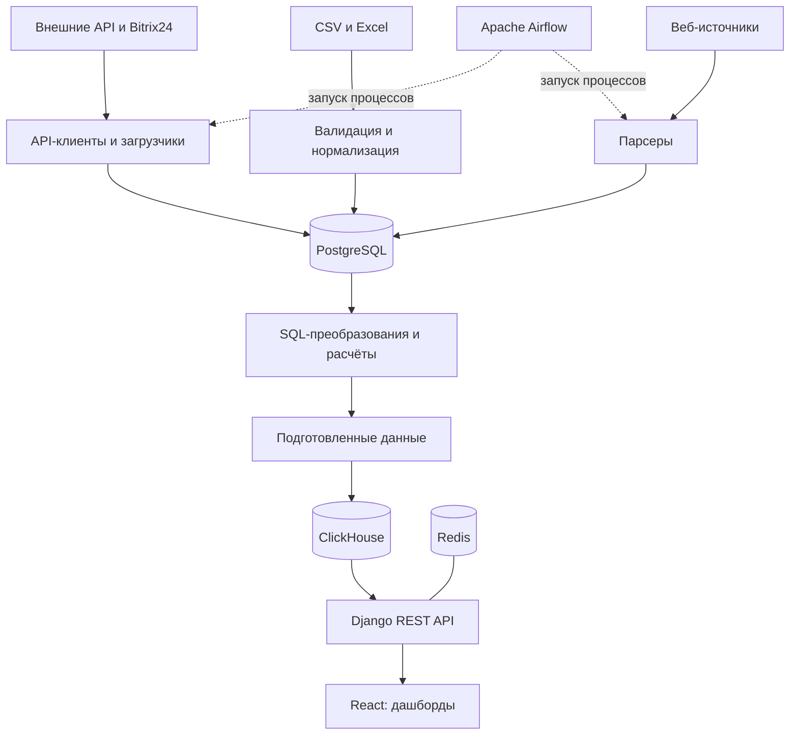

# Analytics Platform

Платформа интеграции данных и построения аналитических витрин на Python, PostgreSQL, ClickHouse и Apache Airflow.

Проект объединяет данные внешних API, CRM, файлов и веб-источников, преобразует их в наборы для аналитики и предоставляет результаты через REST API и дашборды. Предметные области включают продажи, закупки, остатки, оборачиваемость, CRM, поисковый спрос и планирование.

Основной инженерный фокус — повторные и инкрементальные загрузки, согласованность публикации витрин, транзакционный импорт, контроль качества и восстановление состояния процессов после ошибок.

## Технологии

| Область | Технологии и назначение |
| --- | --- |
| Интеграция и обработка | Python, SQL, pandas, HTTP API, CSV/Excel |
| Операционное хранение | PostgreSQL: исходные и подготовленные данные, справочники, журнал загрузок |
| Аналитическое хранение | ClickHouse: аналитические таблицы и снимки витрин |
| Оркестрация | Apache Airflow: расписания, повторы, ограничения выполнения |
| Backend | Django, Django REST Framework, management-команды |
| Кеш и события | Redis, Django Channels |
| Интерфейс | React, Recharts |
| Окружение | Docker Compose |

## Архитектура



Схема показывает общий путь данных; последовательность этапов зависит от модуля. В финансовых пайплайнах выделены исходные и подготовленные таблицы. CRM хранит нормализованные сущности, исходные ответы в `raw_payload`, историю стадий и состояние синхронизации.

Стратегия обновления определяется набором данных: инкрементальный upsert, замена временного среза, полный пересчёт или публикация нового снимка.

## Инженерные кейсы

### 1. Инкрементальная синхронизация CRM

Загрузчик лидов Bitrix24 поддерживает полный, инкрементальный и восстановительный режимы.

При инкрементальном запуске:

1. Читает сохранённое время последнего изменения источника.
2. Сдвигает начальную границу назад на 10 минут.
3. Запрашивает записи по `DATE_MODIFY` с сортировкой по времени изменения и ID.
4. Сохраняет страницы через пакетный upsert по `lead_id`.
5. После успешной загрузки фиксирует позицию источника и статистику запуска.

Перекрытие окна позволяет повторно обработать записи около границы предыдущей загрузки. Upsert обновляет существующие сущности при повторном получении того же ID. Журнал содержит количество полученных, созданных, обновлённых и деактивированных записей.

Удаления обрабатываются при полной загрузке и сверке временного окна: не встреченные в источнике записи помечаются как удалённые. Пустой ответ для непустого локального набора приводит к ошибке до массовой деактивации. Для сверки по дате создания предусмотрены отдельные окна: по умолчанию 14 дней для лидов и четыре календарных месяца для сделок.

Процесс использует блокировку в кеше при запуске и PostgreSQL advisory lock при выполнении. После получения блокировки оставшиеся прерванные запуски переводятся из `RUNNING` в `FAILED`. Это восстанавливает журнал; необходимые данные обрабатываются последующим запуском.

**Реализация:** [загрузка лидов](services/backend/bitrix24/services/loaders/leads.py), [пакетный upsert](services/backend/bitrix24/services/loaders/references.py), [состояние синхронизации](services/backend/bitrix24/services/sync_state.py), [команда обновления](services/backend/bitrix24/management/commands/refresh_bitrix24.py), [окна сверки](services/backend/bitrix24/services/reconciliation_periods.py).

### 2. Публикация витрин через промежуточные таблицы

Публикация Wordstat в ClickHouse выполняется следующим образом:

1. Получить подготовленные данные из PostgreSQL и отклонить пустой набор.
2. Проверить движок базы ClickHouse: `Atomic` или `Shared`.
3. Создать промежуточную таблицу с уникальным именем.
4. Записать данные пакетами по 10 000 строк.
5. Сверить количество записанных строк с исходным набором.
6. Переключить таблицы через `EXCHANGE TABLES`.
7. Удалить промежуточную таблицу, содержащую после обмена предыдущую версию.

До переключения доступна ранее опубликованная таблица. Ошибка вставки или несовпадение числа строк не приводит к переключению на неполный новый набор. Проверка числа строк контролирует полноту переноса, но не заменяет проверку содержимого.

Для снимка CRM-сделок дополнительно реализованы чтение PostgreSQL в транзакции `REPEATABLE READ`, пакетная обработка, идентификатор снимка и обнаружение смены версии при чтении витрины.

Гарантия переключения относится к отдельной таблице. Единой транзакции публикации всех витрин между PostgreSQL и ClickHouse нет.

**Реализация:** [публикация Wordstat](services/backend/analytics/services/yd_wordstat_sync.py), [CRM-снимки и чтение витрины](services/backend/bitrix24/services/crm_marts.py), [публикация аналитики лидов](services/backend/bitrix24/services/clickhouse.py).

### 3. Замена временных срезов и SQL-преобразования

Пайплайн оборачиваемости повторно загружает временные срезы. Период определяется по последней загруженной дате с захватом предыдущего периода. Для исторических месяцев запрашивается срез на конец месяца; для текущего месяца предусмотрены дневные срезы.

Загрузчик нормализует поля, исключает записи без необходимых дат и заменяет данные по `date_stock`. Удаление старого среза и вставка нового выполняются в одной транзакции; `bulk_create` использует пакеты по 5 000 записей.

Транзакционная граница проходит по срезу: ошибка позже не откатывает успешно обработанные предыдущие срезы.

Подготовленная таблица перестраивается через `INSERT … SELECT` с отбором данных текущего месяца и срезов на конец исторических месяцев. Очистка и пересчёт этой таблицы PostgreSQL объединены транзакцией. После синхронизации ClickHouse обновляются кеш и интерфейс отчёта.

**Реализация:** [загрузчик](services/backend/datasets/services/external_api/fb_turnover_api_loader.py), [SQL-преобразование](services/backend/analytics/services/fb_turnover_rebuild_sql.py), [пайплайн](services/backend/analytics/services/fb_turnover_api_pipeline.py), [синхронизация ClickHouse](services/backend/analytics/services/fb_turnover_sync.py).

### 4. Контракты и транзакционный импорт

Модуль планирования поддерживает предварительную проверку и сохранение справочников и фактов. Проверяются обязательные поля, типы, допустимые значения, точность и конечность чисел, дубли бизнес-ключей, ссылки на справочники и согласованность связей.

При сохранении сервер повторно валидирует данные внутри транзакции. Ошибка валидации не приводит к частичному изменению бизнес-данных.

| Набор | Бизнес-ключ |
| --- | --- |
| Товары | SKU |
| Клиенты | Код клиента |
| Склады | Код склада |
| Заказы | Дата + товар + клиент + склад |
| Остатки | Дата + товар + склад |

Импорт заказов заменяет явно объявленный полный период, включая удаление отсутствующих в новом наборе фактов. Для остальных перечисленных наборов используется upsert.

Изменения сериализуются блокировкой строки организации через `SELECT FOR UPDATE NOWAIT`. При конфликте блокировок API возвращает HTTP 409. Журнал сохраняет результат и сведения о пакете; контрольная сумма служит для прослеживаемости и не отменяет повторную валидацию.

**Реализация:** [импорт](services/backend/sps/imports.py), [валидация](services/backend/sps/validation.py), [документация модуля](services/backend/sps/README.md).

## Оркестрация и обработка ошибок

Airflow запускает прикладные процессы через management-команды или внутренние HTTP endpoints. Детальные этапы обработки реализованы в backend; отдельная задача Airflow может выполнять весь пайплайн.

Например, [DAG обновления CRM](airflow/dags/bitrix24_crm_refresh_12h.py) настроен на запуск в 03:10 и 15:10 с понедельника по субботу, один активный запуск, пять повторов задачи и ограничение выполнения в три часа. Автоматическая обработка пропущенных интервалов отключена: `catchup=False`.

[HTTP-клиент Bitrix24](services/backend/bitrix24/services/client.py) использует тайм-ауты, повторы для `429`, `500`, `502`, `503`, `504`, задержку между попытками и `Retry-After`.

Повтор задачи Airflow происходит на уровне команды. Поведение после частичного выполнения определяется транзакционными границами и стратегией обновления конкретного загрузчика.

## Качество данных

[Диагностика CRM](services/backend/bitrix24/services/data_quality.py) возвращает статус, счётчики проблем и сведения о свежести данных.

| Проверка | Что выявляет |
| --- | --- |
| Несопоставленные статусы | Расхождения классификации источника и аналитики |
| Неизвестные ответственные | Нарушения связей со справочником пользователей |
| История стадии без лида | Отсутствующие связанные сущности |
| Отрицательные длительности | Некорректные временные интервалы |
| Время изменения и загрузки | Свежесть данных |

Диагностические проверки и блокирующие проверки загрузчиков имеют разное назначение: наличие диагностики не означает, что она автоматически останавливает каждый пайплайн.

## Тестирование

В репозитории предусмотрены сценарии проверки:

- [повторного импорта, обновления фактов и отклонения некорректных файлов](services/backend/sps/tests/test_imports.py);
- [конфликтов блокировок PostgreSQL и защиты истории от изменений](services/backend/sps/tests/test_postgres.py);
- [календарных окон сверки CRM](services/backend/bitrix24/tests/test_reconciliation_periods.py);
- [ограничений API Wordstat, обработки `429` и сохранения ожидания после перезапуска](services/backend/datasets/tests/test_wordstat_quota.py).

Наличие тестовых сценариев не является отчётом об их прохождении. Для PostgreSQL-специфичных проверок требуется соответствующее окружение; особенности тестирования модуля планирования описаны в [его README](services/backend/sps/README.md).

## Структура репозитория

```text
airflow/dags/                # Оркестрация
services/
├── backend/
│   ├── datasets/            # Источники, загрузчики и парсеры
│   ├── analytics/           # SQL-преобразования и ClickHouse
│   ├── bitrix24/            # CRM, синхронизация и диагностика
│   ├── sps/                 # Импорты и планирование
│   ├── select_market/       # Справочники и ценовая аналитика
│   └── dashboards/          # API, кеш и события обновления
├── frontend/                # Дашборды
└── parser-browser/          # Браузерный сбор данных
docker-compose.yml
```

## Окружение и воспроизводимость

[Docker Compose](docker-compose.yml) описывает PostgreSQL, ClickHouse, Redis, Django, frontend и компоненты Airflow. Конфигурация использует корневой `.env`; внешние интеграции требуют настроек и доступа к соответствующим источникам.

Полный запуск предполагает подготовку окружения, применение миграций, настройку интеграций и загрузку данных. Самодостаточный демонстрационный сценарий с обезличенными данными и проверенная инструкция запуска с чистого окружения пока не подготовлены.

